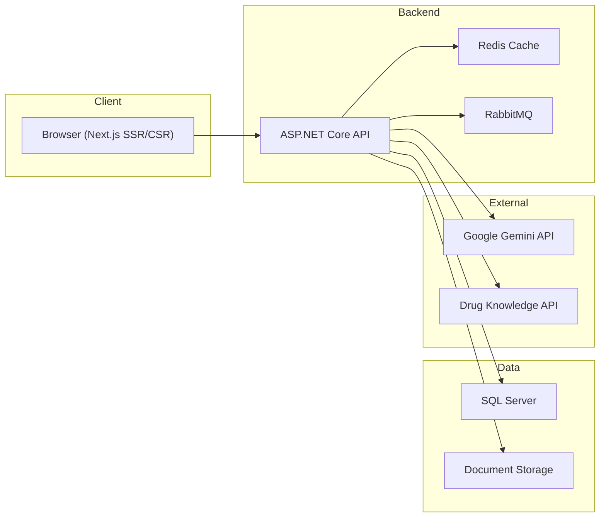

# 01 - Project Overview: ERM System (Electronic Medical Records)

> **Document version:** 1.0 — 2026-11-18  
> **Author:** Senior Software Architect Audit  
> **Scope:** Comprehensive architecture overview of the entire ERM System

---

## 1. System Purpose

**ERM System** (Electronic Records Management / Electronic Medical Records) là hệ thống quản lý hồ sơ bệnh viện tư nhân, bao gồm quản lý bệnh nhân, bác sĩ, lịch hẹn, hồ sơ bệnh án, kê đơn thuốc, billing, clinical orders, và cổng thông tin bệnh nhân (Patient Portal).

Hệ thống phục vụ **4 vai trò chính**: Admin, Doctor, Cashier, Patient.

---

## 2. Tech Stack

### 2.1. Backend (BackE/)

| Component | Technology |
|:---|:---|
| Framework | .NET 8+ (ASP.NET Core Minimal Hosting) |
| Language | C# |
| ORM | Entity Framework Core |
| Database | SQL Server |
| Authentication | JWT Bearer Token + MFA (TOTP) |
| Caching | Redis (with in-memory fallback) |
| Messaging | RabbitMQ (Outbox Pattern) |
| AI Integration | Google Gemini API (Symptom Chat) |
| API Documentation | Scalar (OpenAPI) |
| Observability | OpenTelemetry, Custom Metrics |
| Testing | xUnit, Moq |

### 2.2. Frontend (FontE/)

| Component | Technology |
|:---|:---|
| Framework | Next.js 15+ (App Router) |
| Language | TypeScript |
| Styling | Tailwind CSS 4+ |
| HTTP Client | Axios |
| Notifications | react-hot-toast |
| i18n | Custom implementation (JSON-based) |
| State Management | React Context + useState |

### 2.3. Infrastructure

| Component | Technology |
|:---|:---|
| Containerization | Docker + Docker Compose |
| CI/CD | GitHub Actions |
| Database Seeding | SQL Scripts + PowerShell |

---

## 3. Architecture Overview

### 3.1. Backend — Clean Architecture (4-layer)

```
ERMSystem.sln
├── ERMSystem.Domain          → Entities, Constants (innermost layer)
├── ERMSystem.Application     → Services, DTOs, Interfaces, Utilities
├── ERMSystem.Infrastructure  → Repositories, DbContext, External Services
├── ERMSystem.API             → Controllers, Middleware, Program.cs
└── ERMSystem.Tests           → Unit Tests
```

**Dependency flow:**
```
API → Application → Domain
API → Infrastructure → Application → Domain
```

### 3.2. Frontend — Next.js App Router

```
FontE/
├── app/              → Pages (App Router)
│   ├── (main)/       → Protected admin pages (11 routes)
│   ├── booking/      → Public booking
│   ├── doctors/      → Public doctors listing
│   ├── login/        → Authentication
│   ├── portal/       → Patient portal
│   └── ...           → Other public pages
├── components/       → Reusable components (16 files)
│   ├── layout/       → Header, Sidebar, ProtectedLayout
│   ├── public/       → Public page components
│   └── ui/           → Button, Card, Modal, DataState
├── services/         → API service layer (22 files)
├── contexts/         → AuthContext, I18nContext
├── hooks/            → useAuth, useTranslation
├── lib/              → Utilities (dateFormatting, textEncoding)
├── content/          → Static content
└── i18n/             → Localization files (en.json, vi.json)
```

---

## 4. Domain/Module Identification

### 4.1. Core Business Domains

| Domain | BE Services | FE Pages | Complexity |
|:---|:---|:---|:---|
| **Patient Management** | PatientService | patients/ | High |
| **Appointment Scheduling** | AppointmentService, HospitalAppointmentService | appointments/ | High |
| **Clinical Encounters** | HospitalEncounterService | doctor-worklist/ | High |
| **Prescriptions** | PrescriptionService, HospitalPrescriptionService | prescriptions/ | High |
| **Clinical Orders** | HospitalClinicalOrderService | clinical-orders/ | Medium |
| **Billing & Invoicing** | HospitalBillingService | billing/ | High |
| **Notifications** | NotificationService, HospitalNotificationDeliveryService | notifications/ | Medium |

### 4.2. Supporting Domains

| Domain | BE Services | FE Pages |
|:---|:---|:---|
| **Authentication & Authorization** | AuthService, AdminUserService | login/, security/ |
| **Dashboard & Analytics** | DashboardService | dashboard/ |
| **Doctor Management** | DoctorService, HospitalDoctorService | staff/ |
| **Medicine Catalog** | MedicineService, HospitalCatalogService | — |
| **Patient Portal** | HospitalPatientPortalService | portal/ |
| **AI Symptom Chat** | GeminiSymptomChatService | (AiChatWidget) |

### 4.3. Generic/Infrastructure Domains

| Domain | Components |
|:---|:---|
| **Messaging Infrastructure** | OutboxPublisher, NotificationDispatch, RabbitMQ |
| **Document Storage** | LocalHospitalDocumentStorage, DocumentStorageCleanup |
| **Caching** | DashboardQueryCache, DistributedCacheRuntime |
| **Observability** | ApiMetrics, RequestObservability, OperationalAlerts |
| **CRM Campaigns** | RevisitReminder, SatisfactionSurvey, CustomerCareFollowUp |

---

## 5. Database Architecture

### 5.1. Dual-Database Design

Hệ thống sử dụng **2 DbContext** riêng biệt:

1. **ApplicationDbContext** (`Infrastructure/Data/ApplicationDbContext.cs`)
   - Quản lý: AppUsers, AppRoles
   - Database: `DefaultConnection`
   
2. **HospitalDbContext** (`ERMSystem.Infrastructure/HospitalData/HospitalDbContext.cs`)
   - Quản lý: Hospital-specific entities (Patients, Appointments, Encounters, Prescriptions, Billing, Notifications, Catalog, etc.)
   - Database: `HospitalConnection`

### 5.2. Entity Groups (HospitalDbContext)

- **Patient Entities**: HospitalPatientEntity, PatientAccount, EmergencyContact
- **Scheduling Entities**: Appointments, Doctors, Clinics, Rooms, Specialties
- **EMR Entities**: Encounters, ClinicalNotes, VitalSigns, Attachments
- **Pharmacy Entities**: Prescriptions, PrescriptionItems, Medicines, Dispensing
- **Lab/Imaging Entities**: ClinicalOrders, LabResults, ImagingReports
- **Billing Entities**: Invoices, InvoiceItems, Payments
- **Notification Entities**: OutboxMessages, NotificationDeliveries
- **Organization Entities**: Departments, Floors, ServiceCatalog
- **Identity Entities**: Staff profiles, roles, identity bridge
- **Integration Entities**: AuditLogs, ComplianceAudit

---

## 6. Key Architectural Decisions

| Decision | Implementation | Notes |
|:---|:---|:---|
| **Clean Architecture** | 4-layer separation | Domain has no infrastructure deps |
| **Repository Pattern** | Interfaces in Application, Implementations in Infrastructure | Proper DI |
| **Soft Delete** | `DeletedAtUtc` column pattern | Hospital entities |
| **Outbox Pattern** | Message queue with outbox table | RabbitMQ integration |
| **JWT + MFA** | Custom auth service with TOTP | BCrypt password hashing |
| **BFF-like Pattern** | Hospital-specific services wrapping core entities | Different DTO shapes |
| **Config Validation** | Fail-fast on startup | Custom validation extensions |
| **Rate Limiting** | Configured via ASP.NET Core rate limiter | Per-endpoint policies |

---

## 7. Deployment Architecture



---

## 8. Code Metrics Summary

| Metric | Backend | Frontend |
|:---|:---|:---|
| **Source Files** | ~120 .cs files (excl. migrations) | ~55 .tsx/.ts files |
| **Controllers** | 21 | — |
| **Services** | 20 Application + 20 Infrastructure | 22 service files |
| **Entities (Domain)** | 8 | — |
| **Entities (Hospital)** | ~40+ (10 entity files) | — |
| **DTOs** | ~55 files | 1 massive types.ts (1088 lines) |
| **UI Components** | — | 4 (Button, Card, Modal, DataState) |
| **Test Files** | 14 (10 service + 4 utility) | 0 |
| **Pages** | — | 20 routes |
