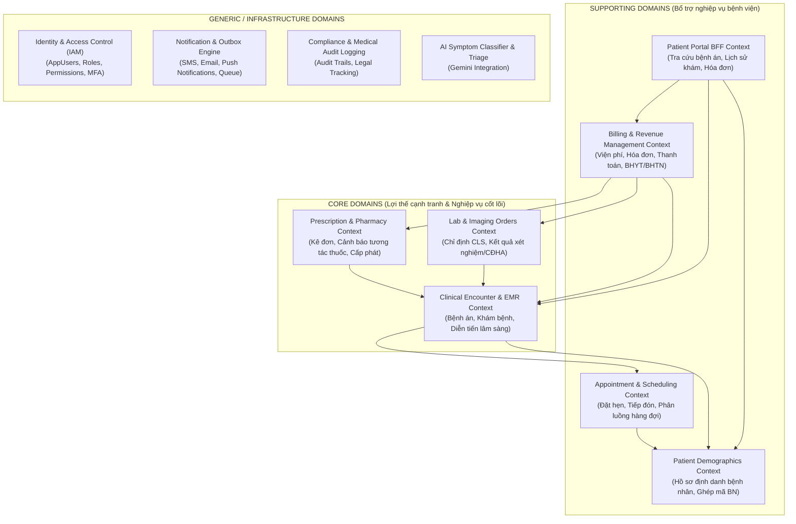
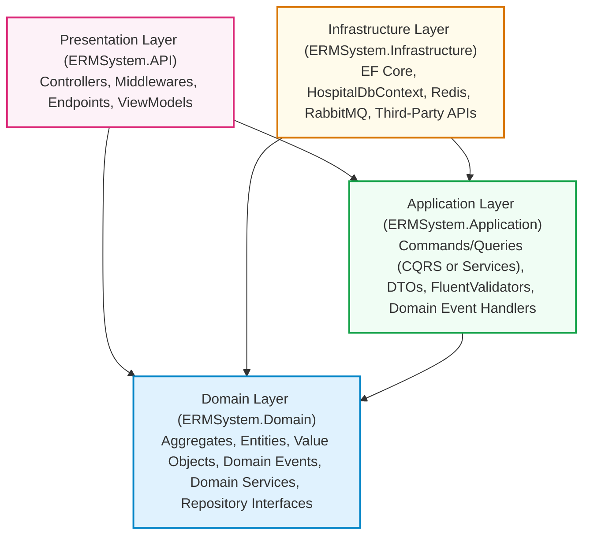
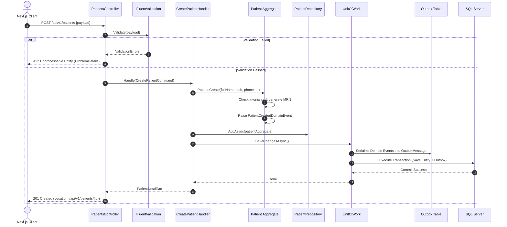
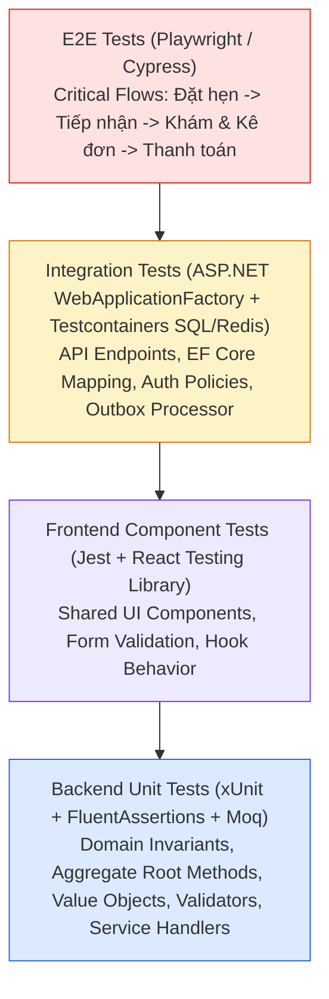

# 04 - Target Architecture Design

> **Document Version:** 1.0 — 2026-11-18  
> **Role:** Senior Software Architect & Full-Stack Tech Lead  
> **Status:** Proposal / Target Blueprint for ERM System Refactoring

---

## 1. Executive Summary & Architectural Philosophy

Hệ thống ERM (Electronic Records Management / Electronic Medical Records) phục vụ nghiệp vụ y tế bệnh viện tư nhân đòi hỏi:
1. **Tính toàn vẹn dữ liệu lâm sàng cực cao (Clinical Data Invariants):** Không cho phép trạng thái mâu thuẫn (ví dụ: toa thuốc không có chẩn đoán hợp lệ, lịch hẹn bị hủy nhưng vẫn phát sinh hóa đơn điều trị).
2. **Khả năng mở rộng phân hệ (Bounded Context Scalability):** Dễ dàng tách các phân hệ (Billing, Pharmacy, Lab/Imaging, Scheduling, Patient Portal) thành sub-modules hoặc microservices trong tương lai mà không làm vỡ Domain Model.
3. **Hiệu năng và trải nghiệm người dùng tối ưu (High UX Fidelity):** Giao diện lâm sàng (bác sĩ, thu ngân, lễ tân) cần thao tác nhanh, chuẩn xác, không rối rắm bởi hiệu ứng AI/gradient không cần thiết; giảm tải re-render và tối ưu truy vấn dữ liệu.

Kiến trúc mục tiêu kết hợp:
- **Clean Architecture + Domain-Driven Design (DDD)** cho Backend (.NET 8+).
- **Feature-Sliced / Domain-Oriented Component Architecture** cho Frontend (Next.js 15+ App Router).
- **Shared Kernel & Design System** đóng vai trò xương sống cho tính nhất quán.

---

## 2. Domain Decomposition & Bounded Contexts

### 2.1. Phân loại Domain (Strategic DDD)



### 2.2. Context Mapping & Quan hệ giữa các Contexts

1. **Patient Registry & Demographics:**
   - **Upstream** cho tất cả các context: Scheduling, EMR, Billing, Portal.
   - Cung cấp Customer/Supplier interface với `PatientId` (Value Object / Strong Entity Identifier).
2. **Clinical Encounter & EMR (Core Context):**
   - Đóng vai trò hạt nhân trong luồng khám chữa bệnh ngoại trú/nội trú.
   - Khi một `Encounter` hoàn tất (`Finalized`/`Approved`), nó phát hành Domain Event `EncounterFinalizedEvent`.
3. **Prescription & Pharmacy:**
   - Lắng nghe sự kiện từ EMR; bảo vệ invariant: *Không được kê đơn thuốc ngoài danh mục hoặc trùng tương tác thuốc nghiêm trọng*.
4. **Billing & Revenue:**
   - **Downstream** nhận charge items từ Clinical Orders, Prescriptions, và Encounter consultation fees.
   - Áp dụng **Saga / Outbox Pattern** để đảm bảo tính nhất quán (Eventual Consistency) giữa lập viện phí và thanh toán cổng ngoài.
5. **Anti-Corruption Layer (ACL):**
   - Tách biệt hoàn toàn giữa `HospitalDbContext` (dữ liệu vật lý quan hệ kế thừa legacy) và Domain Entities thông qua Domain Mappers trong tầng Infrastructure.

---

## 3. Backend Target Architecture (.NET 8 Clean Architecture)

### 3.1. Layer Dependency Rule



> **Nguyên tắc bất biến:**
> - `Domain` không phụ thuộc bất kỳ project/package nào khác (không phụ thuộc EF Core, ASP.NET Core).
> - `Application` chỉ phụ thuộc vào `Domain`.
> - `Infrastructure` phụ thuộc vào `Application` và `Domain`.
> - `API` chỉ điều hướng HTTP request/response và bootstrap DI container.

### 3.2. Detailed Backend Folder Structure

```text
BackE/
├── ERMSystem.sln
│
├── ERMSystem.Domain/                         # DOMAIN LAYER (Zero external dependencies)
│   ├── Common/                               # Shared Kernel
│   │   ├── BaseEntity.cs                     # Base entity với Id generic và Audit trail
│   │   ├── AggregateRoot.cs                  # Base aggregate root với IDomainEvent collection
│   │   ├── ValueObject.cs                    # Base class implements structural equality
│   │   ├── IDomainEvent.cs                   # Marker interface cho Domain Events
│   │   └── Result.cs                         # Railway-oriented Result<T, TError> pattern
│   │
│   ├── Modules/                              # Phân chia theo Bounded Context / Aggregate
│   │   ├── Patients/
│   │   │   ├── Patient.cs                    # Rich Aggregate Root (private setters, invariant methods)
│   │   │   ├── ValueObjects/
│   │   │   │   ├── MedicalRecordNumber.cs    # VO: Format MRN-XXXXXXXX, immutable
│   │   │   │   ├── PhoneNumber.cs            # VO: Chuẩn hóa E.164 hoặc VN phone format
│   │   │   │   ├── EmergencyContact.cs       # VO: Name, Relationship, Phone
│   │   │   │   └── Gender.cs                 # Smart Enum / Value Object
│   │   │   ├── Events/
│   │   │   │   ├── PatientCreatedEvent.cs
│   │   │   │   └── PatientMergedEvent.cs
│   │   │   ├── Rules/                        # Domain Invariants & Specifications
│   │   │   │   └── PatientMustNotBeDuplicateSpecification.cs
│   │   │   └── IPatientRepository.cs         # Repository interface (tối giản theo DDD)
│   │   │
│   │   ├── Appointments/
│   │   │   ├── Appointment.cs                # Aggregate Root
│   │   │   ├── AppointmentStatus.cs          # Smart Enum (Scheduled, CheckedIn, Completed, Cancelled)
│   │   │   ├── Events/
│   │   │   │   ├── AppointmentCheckedInEvent.cs
│   │   │   │   └── AppointmentCancelledEvent.cs
│   │   │   └── IAppointmentRepository.cs
│   │   │
│   │   ├── Encounters/
│   │   │   ├── ClinicalEncounter.cs          # Aggregate Root
│   │   │   ├── ClinicalNote.cs               # Entity
│   │   │   ├── VitalSigns.cs                 # Value Object
│   │   │   ├── EncounterStatus.cs            # Smart Enum (InProgress, Finalized, Approved)
│   │   │   └── IEncounterRepository.cs
│   │   │
│   │   ├── Prescriptions/
│   │   │   ├── Prescription.cs               # Aggregate Root
│   │   │   ├── PrescriptionItem.cs           # Entity
│   │   │   ├── DosageInstruction.cs          # Value Object
│   │   │   ├── PrescriptionStatus.cs         # Smart Enum (Issued, Dispensed, Cancelled)
│   │   │   └── IPrescriptionRepository.cs
│   │   │
│   │   └── Billing/
│   │       ├── Invoice.cs                    # Aggregate Root
│   │       ├── InvoiceItem.cs                # Entity
│   │       ├── Payment.cs                    # Entity
│   │       ├── Money.cs                      # Value Object: Amount + Currency
│   │       ├── InvoiceStatus.cs              # Smart Enum
│   │       └── IInvoiceRepository.cs
│   │
│   └── Exceptions/                           # Domain-level Exceptions
│       ├── DomainException.cs
│       ├── BusinessRuleValidationException.cs
│       └── EntityNotFoundException.cs
│
├── ERMSystem.Application/                    # APPLICATION LAYER (Use Cases & Orchestration)
│   ├── Common/
│   │   ├── Interfaces/
│   │   │   ├── IUnitOfWork.cs                # Transactional boundary
│   │   │   ├── ICurrentUserService.cs        # Current actor context
│   │   │   ├── ICacheService.cs              # Distributed caching abstraction
│   │   │   └── IEventPublisher.cs            # Domain/Integration event dispatcher
│   │   ├── Models/
│   │   │   ├── PaginatedList.cs              # Immutable paged result
│   │   │   └── PageRequest.cs                # Standardized query paging
│   │   └── Exceptions/
│   │       ├── ApplicationException.cs
│   │       ├── ValidationException.cs
│   │       └── UnauthorizedException.cs
│   │
│   ├── Modules/                              # Feature-sliced use cases
│   │   ├── Patients/
│   │   │   ├── Commands/
│   │   │   │   ├── CreatePatient/
│   │   │   │   │   ├── CreatePatientCommand.cs
│   │   │   │   │   ├── CreatePatientValidator.cs   # FluentValidation
│   │   │   │   │   └── CreatePatientHandler.cs
│   │   │   │   ├── UpdatePatient/
│   │   │   │   └── MergePatients/
│   │   │   ├── Queries/
│   │   │   │   ├── GetPatientById/
│   │   │   │   ├── GetPatientsPaged/
│   │   │   │   └── GetDuplicateCandidates/
│   │   │   ├── DTOs/
│   │   │   │   ├── PatientDetailDto.cs
│   │   │   │   └── PatientSummaryDto.cs
│   │   │   └── Mappings/
│   │   │       └── PatientMappingProfile.cs  # Mapster / AutoMapper
│   │   │
│   │   ├── Appointments/                     # Commands, Queries, DTOs, Mappings
│   │   ├── Encounters/
│   │   ├── Prescriptions/
│   │   └── Billing/
│   │
│   └── DependencyInjection.cs                # Automatic Assembly Scanning DI
│
├── ERMSystem.Infrastructure/                 # INFRASTRUCTURE LAYER (Technical Concerns)
│   ├── Persistence/
│   │   ├── Contexts/
│   │   │   └── HospitalDbContext.cs          # EF Core DbContext with Configurations
│   │   ├── Configurations/                   # IEntityTypeConfiguration per Aggregate
│   │   │   ├── PatientConfiguration.cs
│   │   │   ├── AppointmentConfiguration.cs
│   │   │   ├── EncounterConfiguration.cs
│   │   │   └── ...
│   │   ├── Repositories/                     # Generic + Specific Repositories
│   │   │   ├── RepositoryBase.cs
│   │   │   ├── PatientRepository.cs
│   │   │   └── ...
│   │   ├── UnitOfWork.cs                     # Transaction coordinator
│   │   └── Outbox/
│   │       ├── OutboxMessage.cs
│   │       └── OutboxPublisherBackgroundService.cs
│   │
│   ├── Caching/
│   │   └── RedisDistributedCacheService.cs
│   ├── Messaging/
│   │   └── RabbitMqEventPublisher.cs
│   ├── ExternalServices/
│   │   ├── GeminiAiClient.cs
│   │   └── ExternalDrugKnowledgeClient.cs
│   ├── Security/
│   │   ├── JwtTokenGenerator.cs
│   │   ├── BcryptPasswordHasher.cs
│   │   └── TotpMfaProvider.cs
│   └── DependencyInjection.cs
│
└── ERMSystem.API/                            # PRESENTATION LAYER
    ├── Controllers/
    │   ├── BaseApiController.cs              # Standardized API response wrappers
    │   ├── PatientsController.cs
    │   ├── AppointmentsController.cs
    │   ├── EncountersController.cs
    │   ├── PrescriptionsController.cs
    │   ├── BillingController.cs
    │   └── ...
    ├── Middleware/
    │   ├── ApiExceptionHandlingMiddleware.cs # Global ProblemDetails RFC 7807
    │   ├── RequestObservabilityMiddleware.cs
    │   └── SecurityHeadersMiddleware.cs
    ├── Extensions/
    │   ├── ServiceCollectionExtensions.cs
    │   └── HostExtensions.cs
    ├── Program.cs                            # Clean minimal bootstrap (~80 lines)
    └── appsettings.json
```

---

## 4. Request Lifecycle & Execution Flow



---

## 5. Frontend Target Architecture (Next.js 15+ App Router)

### 5.1. Architectural Pattern: Feature-Driven Domain Slices

Thay vì gom toàn bộ 1000+ dòng code vào một file `page.tsx`, kiến trúc mục tiêu áp dụng mô hình **Container-Presenter + Feature Slices**:

```text
FontE/
├── app/                                      # Next.js App Router (Chỉ làm Route Entrypoint & Layout)
│   ├── (main)/
│   │   ├── layout.tsx                        # Admin / Staff Layout Shell
│   │   ├── dashboard/page.tsx                # Thin wrapper: imports <DashboardPage />
│   │   ├── patients/page.tsx                 # Thin wrapper: imports <PatientManagementView />
│   │   ├── appointments/page.tsx
│   │   ├── doctor-worklist/page.tsx
│   │   ├── clinical-orders/page.tsx
│   │   ├── prescriptions/page.tsx
│   │   ├── billing/page.tsx
│   │   ├── medical-records/page.tsx
│   │   ├── security/page.tsx
│   │   └── staff/page.tsx
│   ├── booking/page.tsx                      # Public Patient Booking View
│   ├── portal/page.tsx                       # Patient Portal View
│   ├── login/page.tsx
│   ├── layout.tsx                            # Root Layout (Fonts, Providers)
│   └── globals.css
│
├── features/                                 # FEATURE MODULES (Mỗi domain có slice riêng biệt)
│   ├── patients/
│   │   ├── api/                              # Feature-specific API endpoints & query keys
│   │   │   └── patientApi.ts
│   │   ├── hooks/                            # Custom hooks đóng gói Business & Fetching Logic
│   │   │   ├── usePatientsList.ts            # Quản lý query, debounce, pagination, filter
│   │   │   ├── usePatientDrawer.ts           # Quản lý chi tiết lịch sử khám / appointment drawer
│   │   │   └── usePatientMutations.ts        # Create, Update, Delete, Merge mutations
│   │   ├── components/                       # Sub-components chuyên trách
│   │   │   ├── PatientTable.tsx              # Presenter: Render bảng bệnh nhân
│   │   │   ├── PatientTableRow.tsx           # Dòng đơn lẻ + action buttons
│   │   │   ├── PatientSearchFilter.tsx       # Thanh tìm kiếm + page size selector
│   │   │   ├── PatientFormModal.tsx          # Modal thêm / sửa hồ sơ
│   │   │   ├── PatientDetailDrawer.tsx       # Slide-over xem lịch sử khám & chỉ số
│   │   │   ├── PatientMetricsCards.tsx       # 2 metric cards thống kê đầu trang
│   │   │   └── PatientMergeModal.tsx         # Modal ghép trùng hồ sơ
│   │   ├── types/                            # Domain-specific DTO interfaces
│   │   │   └── patient.types.ts
│   │   └── views/
│   │       └── PatientManagementView.tsx     # Coordinator Container gom các components lại
│   │
│   ├── appointments/                         # api/, hooks/, components/, types/, views/
│   ├── doctor-worklist/
│   ├── clinical-orders/
│   ├── prescriptions/
│   ├── billing/
│   └── patient-portal/
│
├── shared/                                   # SHARED KERNEL & DESIGN SYSTEM
│   ├── ui/                                   # Reusable UI Component Library (Design Tokens-based)
│   │   ├── Button/
│   │   │   ├── Button.tsx
│   │   │   └── Button.types.ts
│   │   ├── Input/
│   │   │   ├── TextInput.tsx
│   │   │   ├── SearchInput.tsx
│   │   │   └── Input.types.ts
│   │   ├── Select/
│   │   │   └── Select.tsx
│   │   ├── Modal/
│   │   │   ├── Modal.tsx
│   │   │   └── ConfirmDialog.tsx             # Thay thế hoàn toàn window.confirm()
│   │   ├── Drawer/
│   │   │   └── Drawer.tsx                    # Slide-over drawer chuẩn accessibility
│   │   ├── Table/
│   │   │   ├── Table.tsx
│   │   │   ├── TableHeader.tsx
│   │   │   ├── TableBody.tsx
│   │   │   └── TablePagination.tsx           # Shared pagination control
│   │   ├── Badge/
│   │   │   └── Badge.tsx                     # Variant: success, warning, error, neutral
│   │   ├── Card/
│   │   │   └── Card.tsx
│   │   ├── DataState/
│   │   │   ├── EmptyState.tsx
│   │   │   ├── ErrorState.tsx
│   │   │   └── SkeletonTable.tsx
│   │   └── Tabs/
│   │       └── Tabs.tsx
│   │
│   ├── hooks/                                # Shared hooks
│   │   ├── useDebounce.ts
│   │   ├── usePagination.ts
│   │   └── useDisclosure.ts                  # Manage open/close modals, drawers
│   │
│   ├── services/                             # Core HTTP client & Storage
│   │   ├── httpClient.ts                     # Axios client + refresh interceptor
│   │   ├── tokenStorage.ts
│   │   └── errorHandling.ts
│   │
│   ├── lib/                                  # Pure utilities
│   │   ├── dateTime.ts                       # Date formatting / locale aware
│   │   ├── currency.ts                       # Format VND/USD chuẩn y tế
│   │   └── validation.ts                     # Zod helpers
│   │
│   └── constants/                            # Shared constants
│       ├── permissions.ts
│       └── appConfig.ts
```

### 5.2. Giải thích trách nhiệm từng phân tầng Frontend

| Thư mục | Trách nhiệm | Không được phép làm |
|:---|:---|:---|
| `app/` | Khai báo route, metadata, server layout, middleware auth gate. | Chứa JSX giao diện phức tạp (> 50 dòng) hoặc state nghiệp vụ. |
| `features/{feature}/views/` | Đóng vai trò Page Container: kết nối hooks với presenter components. | Gọi trực tiếp `axios` hoặc can thiệp format data nội bộ. |
| `features/{feature}/hooks/` | Quản lý state, fetch data, mutation, cache sync, side-effects. | Render JSX. |
| `features/{feature}/components/` | Presenter components: nhận props, emit events qua callbacks. | Gọi API trực tiếp hoặc xử lý global state. |
| `shared/ui/` | Thư viện UI nguyên tử (Atoms/Molecules): Button, Table, Input, Modal. | Chứa bất kỳ logic nghiệp vụ nào liên quan đến bệnh viện (ERM). |

---

## 6. Communication Between Modules

### 6.1. Backend Module Communication

1. **In-Process Communication (Synchronous Queries):**
   - Các module giao tiếp qua **Application Interfaces** hoặc **Mediator Handlers**.
   - Không reference chéo DbContext; mỗi aggregate chỉ truy xuất qua repository của aggregate đó.
2. **Cross-Aggregate Side Effects (Asynchronous Events):**
   - Sử dụng **Domain Events** cho các tác vụ cùng transaction boundary.
   - Sử dụng **Transactional Outbox Pattern** với RabbitMQ cho các tác vụ cần gửi thông báo, đồng bộ sang hệ thống bên ngoài, hoặc trigger background workflows (Revisit Reminders, Survey Campaigns).

### 6.2. Frontend Module Communication

1. Không import chéo các component con giữa các feature khác nhau (ví dụ: `features/billing` không được import component nội bộ của `features/patients`).
2. Giao tiếp giữa các feature thông qua:
   - URL State / Query Parameters (`?patientId=...`, `?appointmentId=...`).
   - Shared Types từ Shared Kernel.
   - Global Context hoặc Event Bus nếu thực sự cần thiết (tránh lạm dụng).

---

## 7. Testing Strategy



---

## 8. Adaptation of Enterprise Coding Guidelines

Tài liệu quy chuẩn gốc được viết cho hệ sinh thái **Java / Spring Boot**. Sau đây là bảng ánh xạ và chuẩn hóa sang **.NET 8 / C# & Next.js / TypeScript**:

| Quy chuẩn Spring Boot (Tài liệu gốc) | Chuẩn hóa sang .NET 8 / C# (Target) | Lý do kiến trúc & Thực tiễn .NET |
|:---|:---|:---|
| Kế thừa `AbstractAuditingEntity<Long>` | Kế thừa `BaseEntity<Guid>` hoặc `AuditableAggregateRoot<Guid>` | Hệ thống y tế dùng `Guid` chống đoán ID, hỗ trợ sinh ID offline/distributed. |
| `@Index` annotation trên Entity Class | EF Core `IEntityTypeConfiguration<T>` với `.HasIndex()` | Clean Architecture: Domain Entity thuần khiết, cấu hình mapping DB để ở Infrastructure. |
| Override `equals()` & `hashCode()` bắt buộc | Kế thừa `ValueObject` cho VOs, so sánh `Id` cho Entities | C# record types hoặc base Entity class đã hỗ trợ equality an toàn. |
| MapStruct Mapper | **Mapster** hoặc **AutoMapper** profile | Mapster có hiệu năng biên dịch IL cao nhất trong .NET, zero reflection overhead. |
| `@Transactional(readOnly = true)` | `IUnitOfWork` + EF Core `AsNoTracking()` | EF Core tối ưu truy vấn qua `AsNoTracking()`; transaction được điều khiển qua Unit of Work. |
| Repository chỉ 4 hàm tối giản | `IRepository<T>` (CRUD chuẩn) + Domain Queries chuyên biệt | Tuân thủ Domain-Driven Design và Interface Segregation Principle (ISP). |
| Spring `@PreAuthorize("hasPermission(...)")` | ASP.NET Core `[Authorize(Policy = AppPermissions.X)]` | Khai báo Policy-based Authorization chuẩn .NET Core, type-safe bằng hằng số. |
| Message Bundle `messages.properties` | `IStringLocalizer<T>` hoặc Resource (.resx) với Error Code Keys | Chuẩn localization của Microsoft, tích hợp trực tiếp vào ProblemDetails RFC 7807. |
| BFF tách Mobile/Web Controller | **API Versioning** (`/api/v1/web/`, `/api/v1/mobile/` hoặc chung DTO qua projection) | Trong .NET, controller mỏng delegate về Mediator/Service, có thể tái sử dụng tối đa logic. |
