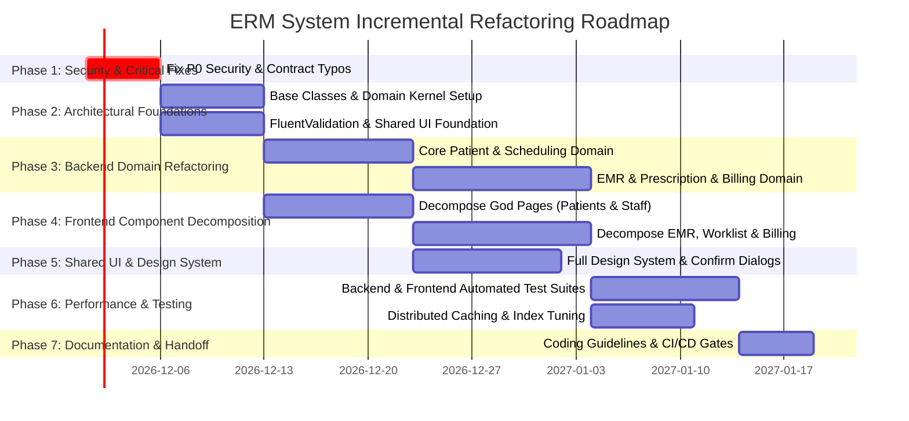

# 05 - Refactoring Roadmap & Implementation Plan

> **Document Version:** 1.0 — 2026-11-18  
> **Role:** Senior Software Architect & Full-Stack Tech Lead  
> **Approach:** Incremental Refactoring (Branch by Abstraction & Strangler Fig Pattern)  
> **Golden Rule:** Zero Downtime, zero regression of current hospital business rules.

---

## 1. Roadmap Overview & Timeline

Quá trình refactor được chia làm **7 giai đoạn tuần tự**. Mỗi giai đoạn đều có **Acceptance Criteria** độc lập và có thể deploy/release an toàn mà không làm gián đoạn vận hành bệnh viện:



---

## 2. Phase Breakdown

---

### Phase 1: P0 Critical Fixes & Contract Corrections

#### 1. Mục tiêu
Giải quyết ngay lập tức các lỗ hổng bảo mật nghiêm trọng (P0) và các lỗi sai lệch hợp đồng API ảnh hưởng trực tiếp đến hệ thống.

#### 2. Vấn đề giải quyết & Files liên quan
- **BE-013:** `AppUser.PasswordHash` có public setter → [AppUser.cs](file:///c:/VietDang/ERMSystem_CleanAchitecture/BackE/ERMSystem.Domain/Entities/AppUser.cs).
- **FE-007:** API query parameter typo `textSeach` vs `textSearch` → [patientService.ts](file:///c:/VietDang/ERMSystem_CleanAchitecture/FontE/services/patientService.ts), [PatientRepository.cs](file:///c:/VietDang/ERMSystem_CleanAchitecture/BackE/ERMSystem.Infrastructure/Repositories/PatientRepository.cs).
- **BE-004:** Thêm validation cơ bản chống bypass dữ liệu rỗng/vượt ngưỡng cho auth & user DTOs.

#### 3. Các bước triển khai cụ thể
1. Đóng encapsulation cho `AppUser.PasswordHash`: chuyển sang `public string PasswordHash { get; private set; }`, bổ sung method `UpdatePasswordHash(string newHash)` có kiểm tra null/empty.
2. Kiểm tra tất cả các nơi đang set trực tiếp `PasswordHash` trong `AuthService.cs` và `AdminUserService.cs` để chuyển sang gọi method `UpdatePasswordHash`.
3. Chuẩn hóa tham số tìm kiếm trong API: thống nhất dùng `textSearch` chuẩn, giữ fallback ngầm trong middleware hoặc route mapping 1 sprint trước khi deprecate hoàn toàn `textSeach`.
4. Xóa bỏ workaround nối URL kép `&textSearch=...&textSeach=...` tại frontend `patientService.ts`.

#### 4. Dependency & Rủi ro
- **Dependency:** Không phụ thuộc task khác.
- **Rủi ro:** Có thể gây lỗi đăng ký/đổi mật khẩu nếu bỏ sót vị trí gán mật khẩu.
- **Giảm thiểu:** Chạy toàn bộ test suite `AdminUserServiceTests.cs` và kiểm thử thủ công luồng login/register/reset password.

#### 5. Acceptance Criteria & Verification
- [ ] Property `PasswordHash` không thể bị gán tùy tiện từ bên ngoài class `AppUser`.
- [ ] Đăng nhập, đổi mật khẩu và đăng ký tài khoản bệnh nhân hoạt động bình thường 100%.
- [ ] Frontend chỉ truyền duy nhất tham số `textSearch` và kết quả tìm kiếm danh sách bệnh nhân hoạt động chính xác.

---

### Phase 2: Architectural Foundations & Shared Kernel

#### 1. Mục tiêu
Thiết lập các cấu trúc nền tảng dùng chung (Shared Kernel) cho cả Backend và Frontend mà không làm ảnh hưởng đến code hiện tại.

#### 2. Modules & Files tạo mới
- **Backend Domain Kernel:**
  - `ERMSystem.Domain/Common/BaseEntity.cs` (Audit fields: `CreatedAtUtc`, `CreatedBy`, `UpdatedAtUtc`, `UpdatedBy`, `DeletedAtUtc`).
  - `ERMSystem.Domain/Common/ValueObject.cs` (Structural equality).
  - `ERMSystem.Domain/Common/AggregateRoot.cs` (Domain events list: `IReadOnlyCollection<IDomainEvent>`).
  - `ERMSystem.Domain/Common/IDomainEvent.cs`.
- **Backend Application Foundation:**
  - Setup FluentValidation pipeline tự động qua Dependency Injection.
  - Setup Mapster / AutoMapper profile dùng chung.
  - Setup `ApiExceptionHandlingMiddleware` trả về chuẩn **RFC 7807 ProblemDetails**.
- **Frontend Shared Foundation:**
  - `FontE/shared/ui/` skeleton: Bổ sung `Input`, `Select`, `Badge`, `ConfirmDialog`.
  - `FontE/features/` folder structure initialization.

#### 3. Các bước triển khai cụ thể
1. Tạo thư mục `Domain/Common/` và triển khai các base class chuẩn Clean Architecture.
2. Thêm package `FluentValidation.DependencyInjectionExtensions` và cấu hình scanning trong `Application/DependencyInjection.cs`.
3. Bổ sung `ConfirmDialog.tsx` trong `FontE/shared/ui/Modal/` để chuẩn bị thay thế `window.confirm()`.
4. Cấu hình ESLint rules và TypeScript path aliases (`@/features/*`, `@/shared/*`).

#### 4. Acceptance Criteria & Verification
- [ ] Solution .NET build thành công với 0 warnings/errors.
- [ ] Frontend Next.js build thành công với các path alias mới.
- [ ] Test thử nghiệm 1 validator với FluentValidation hoạt động chính xác qua unit test.

---

### Phase 3: Backend Domain & Clean Architecture Refactoring

#### 1. Mục tiêu
Chuyển đổi từng Aggregate từ Anemic Model sang Rich Domain Model, bảo vệ Business Invariants tại tầng Domain, dọn dẹp Fat Repositories.

#### 2. Kế hoạch refactor theo từng phân hệ (Sub-Phases)

##### 3.1. Phân hệ Bệnh nhân (Patient Aggregate)
- **Files:** `Patient.cs`, `IPatientRepository.cs`, `PatientRepository.cs`, `PatientService.cs`.
- **Nội dung:**
  - Biến `Patient` thành Aggregate Root kế thừa `AuditableAggregateRoot<Guid>`.
  - Private setters cho: `FullName`, `DateOfBirth`, `Gender`, `Phone`.
  - Tạo Value Objects: `MedicalRecordNumber`, `EmergencyContact`.
  - Chuyển logic Merge bệnh nhân (`MergeWith(Patient source, string actor)`) từ `PatientService` vào phương thức nội tại của `Patient` Aggregate.
  - Rút gọn `IPatientRepository`: chỉ giữ các phương thức nạp/lưu Aggregate; chuyển logic query thống kê dashboard sang Service/Query Handler riêng biệt.

##### 3.2. Phân hệ Lịch hẹn & Tiếp nhận (Appointment & Encounter Aggregates)
- **Files:** `Appointment.cs`, `ClinicalEncounter.cs`, `AppointmentStatuses.cs`, `EncounterStatuses.cs`.
- **Nội dung:**
  - Chuyển `Status` từ `string` sang Smart Enum có kiểm soát state machine (ví dụ: `Scheduled` -> `CheckedIn` -> `Completed`; cấm chuyển từ `Cancelled` sang `Completed`).
  - Thêm phương thức domain `CheckIn(string counterLabel)`, `Cancel(string reason)`.
  - Tách logic tự động cập nhật `UpdatedAtUtc` khi thực hiện thao tác qua Domain Event.

##### 3.3. Phân hệ Kê đơn & Dược (Prescription & Pharmacy)
- **Files:** `Prescription.cs`, `PrescriptionItem.cs`, `HospitalPrescriptionService.cs`.
- **Nội dung:**
  - Bảo vệ invariant: Không thể tạo toa thuốc rỗng (không có item nào).
  - Validation liều lượng (`DosageInstruction`) qua Value Object.
  - Tách rule kiểm tra tương tác thuốc (`IExternalDrugKnowledgeProvider`) thành Domain Service.

##### 3.4. Phân hệ Viện phí (Billing & Invoicing)
- **Files:** `HospitalBillingService.cs`, `HospitalBillingRepository.cs`.
- **Nội dung:**
  - Đảm bảo tính toán số tiền `TotalAmount = Subtotal - Discount + Insurance` là bất biến nội tại của `Invoice`.
  - Chuyển đổi trạng thái hóa đơn qua method `ApplyPayment(Payment payment)`.

#### 3. Rủi ro & Phương án giảm thiểu
- **Rủi ro:** Thay đổi signature entity làm vỡ EF Core mapping hiện tại.
- **Giảm thiểu:** Sử dụng EF Core `PropertyAccessMode.Field` và `IEntityTypeConfiguration` tương thích với private setters, không cần xóa database hiện tại.

#### 4. Acceptance Criteria
- [ ] Toàn bộ 14 unit test hiện có pass 100%.
- [ ] Bổ sung ít nhất 30 unit tests mới cho các Aggregate Methods (Patient.MergeWith, Appointment.CheckIn, Invoice.ApplyPayment...).

---

### Phase 4: Frontend Component Decomposition & Feature Slices

#### 1. Mục tiêu
Xóa bỏ hoàn toàn "God Page Components" (500-1500 dòng/file). Tái cấu trúc theo Feature Slices với phân tách rõ ràng giữa State/Logic (`useFeatureHook`) và UI Display (`PresenterComponents`).

#### 2. Kế hoạch phân rã chi tiết cho màn hình Bệnh nhân (`patients/page.tsx` - 1084 dòng)

```text
CẤU TRÚC SAU KHI TÁCH:
FontE/features/patients/
├── api/patientApi.ts                          (~40 dòng)  -> Gọi API qua axios
├── hooks/
│   ├── usePatientsList.ts                     (~120 dòng) -> Xử lý search debounce, pagination, role doctor filter
│   ├── usePatientDrawer.ts                    (~80 dòng)  -> Load appointment/encounter history khi click dòng
│   └── usePatientForm.ts                      (~70 dòng)  -> Quản lý form create/update
├── components/
│   ├── PatientHeaderMetrics.tsx               (~50 dòng)  -> 2 card số liệu đầu trang
│   ├── PatientSearchFilter.tsx                (~60 dòng)  -> Search input + page size dropdown
│   ├── PatientTable.tsx                       (~110 dòng) -> Table rendering + empty/error states
│   ├── PatientTableRow.tsx                    (~80 dòng)  -> Dòng dữ liệu + Action buttons
│   ├── PatientDetailDrawer.tsx                (~150 dòng) -> Drawer xem hồ sơ chi tiết
│   ├── PatientFormModal.tsx                   (~100 dòng) -> Modal thêm/sửa bệnh nhân
│   └── PatientMergeModal.tsx                  (~90 dòng)  -> Modal ghép trùng
└── views/
    └── PatientManagementView.tsx              (~70 dòng)  -> Coordinator component gắn kết tất cả
```

File route `FontE/app/(main)/patients/page.tsx` chỉ còn lại:
```tsx
import { PatientManagementView } from "@/features/patients/views/PatientManagementView";

export default function PatientsPage() {
  return <PatientManagementView />;
}
```

#### 3. Lộ trình thực hiện cho các trang còn lại:
1. `features/appointments/` (tách từ `appointments/page.tsx`).
2. `features/doctor-worklist/` (tách từ `doctor-worklist/page.tsx`).
3. `features/clinical-orders/` (tách từ `clinical-orders/page.tsx`).
4. `features/billing/` (tách từ `billing/page.tsx`).
5. `features/prescriptions/` (tách từ `prescriptions/page.tsx`).

#### 4. Acceptance Criteria
- [ ] Không có file component nào vượt quá 200 dòng code.
- [ ] Hành vi và trải nghiệm người dùng giữ nguyên 100% (không đổi luồng nghiệp vụ).
- [ ] Không xuất hiện console errors hay warning về memory leak khi chuyển trang.

---

### Phase 5: Shared UI System & Professional UI/UX Refinement

#### 1. Mục tiêu
Thay thế toàn bộ các markup HTML rời rạc bằng bộ Shared UI Component System; loại bỏ `window.confirm()`; chuẩn hóa visual hierarchy theo chuẩn hệ thống y tế chuyên nghiệp.

#### 2. Các thành phần triển khai
1. **Thay thế `window.confirm`:** Áp dụng `ConfirmDialog` cho toàn bộ các hành động xóa/hủy trong bệnh nhân, lịch hẹn, toa thuốc, người dùng.
2. **Chuẩn hóa Data Tables:** Đưa component `Table`, `TableHeader`, `TableBody`, `TablePagination` vào sử dụng chung.
3. **Chuẩn hóa Form Controls:** Thay thế các input/select trần bằng `TextInput`, `Select`, `SearchInput`.
4. **Loại bỏ phong cách AI-Generated UI:**
   - Thay các avatar gradient xanh sặc sỡ bằng tông màu Slate/Medical Blue trung tính.
   - Giảm bớt các lớp đổ bóng gắt (`shadow-2xl`) sang `shadow-sm` tinh tế.
   - Bổ sung icon vector nhất quán (tích hợp `lucide-react`) thay thế các chữ viết tắt `"DT"`, `"BS"`, `"DC"`.

#### 3. Acceptance Criteria
- [ ] Không còn bất kỳ lời gọi `window.confirm` nào trong toàn bộ dự án frontend.
- [ ] 100% bảng dữ liệu trong các trang quản trị dùng chung `TablePagination`.
- [ ] Giao diện đồng nhất về font chữ, màu sắc, border radius và padding.

---

### Phase 6: Performance Optimization & Comprehensive Automated Testing

#### 1. Mục tiêu
Tăng tốc độ truy vấn, kiểm soát N+1 query, bổ sung integration tests cho các luồng nghiệp vụ nhạy cảm (Billing, Prescriptions, Encounters).

#### 2. Các công việc cụ thể
1. **EF Core Query Optimization:**
   - Đảm bảo tất cả query dạng đọc danh sách đều có `.AsNoTracking()`.
   - Sử dụng `.ExecuteUpdateAsync()` và `.ExecuteDeleteAsync()` cho các tác vụ cập nhật/xóa hàng loạt thay vì nạp toàn bộ danh sách vào bộ nhớ rồi SaveChanges.
2. **Caching Strategy:**
   - Áp dụng Redis Cache tagging / eviction khoa học cho Dashboard và danh mục thuốc/dịch vụ (Service Catalog).
3. **Backend Integration Testing:**
   - Khởi tạo project `ERMSystem.IntegrationTests` dùng `Microsoft.AspNetCore.Mvc.Testing.WebApplicationFactory`.
   - Viết Integration Tests cho luồng: Tạo bệnh nhân → Đặt lịch hẹn → Khám & Kê toa → Xuất viện phí.
4. **Frontend Unit & Component Testing:**
   - Cài đặt Jest + React Testing Library.
   - Viết test cho `Button`, `Modal`, `ConfirmDialog`, `useDebounce`, `usePagination`.

#### 3. Acceptance Criteria
- [ ] Tốc độ phản hồi API phân trang bệnh nhân & danh sách khám < 100ms với dataset 10,000 bản ghi.
- [ ] Test coverage Backend đạt tối thiểu 70% trên tầng Domain & Application.
- [ ] Toàn bộ Integration Tests pass trong CI pipeline.

---

### Phase 7: Documentation, CI/CD Gates & Team Guidelines

#### 1. Mục tiêu
Đóng gói quy chuẩn lập trình mới vào tài liệu dự án và thiết lập kiểm tra tự động trong quy trình CI/CD.

#### 2. Các công việc cụ thể
1. Viết tài liệu `DEVELOPER_GUIDE.md` cập nhật cách tạo mới một Module/Feature theo Clean Architecture & Feature Slices.
2. Bổ sung script kiểm tra kiến trúc tự động:
   - Dùng `NetArchTest.Rules` trong .NET để ngăn chặn việc `Domain` reference các tầng ngoài.
   - Cấu hình ESLint rule cấm import chéo giữa các feature ở Frontend.
3. Cập nhật GitHub Actions CI Workflow:
   - Tự động chạy `dotnet test` và `npm run lint && npm run test` trên mỗi Pull Request.

---

## 3. Risk Management & Mitigation Matrix

| Rủi ro kỹ thuật | Mức độ | Xác suất | Giải pháp phòng ngừa & Giảm thiểu |
|:---|:---:|:---:|:---|
| **Làm gián đoạn nghiệp vụ bệnh viện khi sửa logic Entity** | Cao | Thấp | Áp dụng Branch by Abstraction; giữ nguyên database schema trong giai đoạn đầu; viết Unit Tests kiểm chứng trước khi refactor. |
| **Breaking API hợp đồng giữa BE và FE** | Cao | Thấp | Không thay đổi tên trường JSON (camelCase format giữ nguyên); mọi thay đổi DTO đều thông qua API contract tests. |
| **Phình to scope công việc (Scope Creep)** | Trung bình | Cao | Tuân thủ nghiêm ngặt Task Breakdown theo từng sprint; chỉ refactor cấu trúc, không tự tiện thêm tính năng mới. |
| **Xung đột mã nguồn (Merge Conflicts) do chuyển file** | Trung bình | Trung bình | Tách nhỏ PR theo từng Feature slice; merge liên tục vào nhánh develop. |
