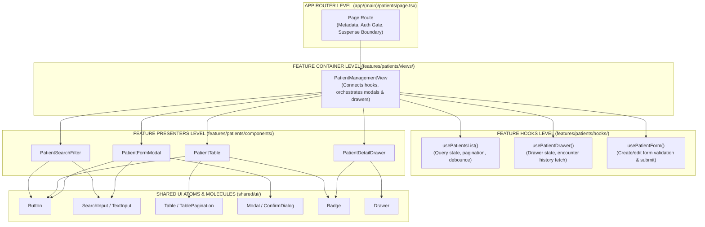

# 06 - Frontend Design System & Component Architecture

> **Document Version:** 1.0 — 2026-11-18  
> **Role:** Senior Full-Stack Tech Lead & UI/UX Architect  
> **Domain:** Hospital Information & Clinical Systems (ERM/EMR)  
> **Target Standard:** Enterprise Grade, WCAG 2.1 AA Accessible, Production Ready

---

## 1. UI/UX Philosophy for Clinical Enterprise Software

Hệ thống y tế và quản lý hồ sơ bệnh viện (ERM/EMR) đòi hỏi một phong cách thiết kế **nghiêm cẩn, chính xác, độ tương phản cao và độ tin cậy tuyệt đối**. Nhân viên y tế, bác sĩ và thu ngân phải thao tác hàng trăm lượt mỗi ngày dưới áp lực công việc lớn.

### 1.1. Các nguyên tắc "Anti-AI-Generated" & "Anti-Dribbble"
1. **Loại bỏ hiệu ứng trang trí thừa (No Gimmicks):**
   - Không lạm dụng hiệu ứng kính mờ (`glassmorphism`, `backdrop-blur` nặng nề).
   - Không sử dụng gradient đa sắc sặc sỡ trên các nút bấm, avatar hoặc bảng biểu.
   - Loại bỏ đổ bóng quá sâu (`shadow-2xl`) gây rối mắt; ưu tiên đường viền phân tách mỏng (`border-slate-200`) kết hợp đổ bóng tinh tế (`shadow-xs`, `shadow-sm`).
2. **Tránh hội chứng "Mọi thứ đều là Card" (Card Overuse):**
   - Không bọc từng dòng thông tin vào một card riêng biệt.
   - Sử dụng các kỹ thuật phân cấp thị giác hiện đại: dòng kẻ ngang tinh tế (`divide-y`), khoảng cách nhịp nhàng (`spacing rhythm`), và màu nền xen kẽ nhẹ (`bg-slate-50/50`).
3. **Mật độ thông tin tối ưu (Information Density for Healthcare):**
   - Bảng dữ liệu y tế cần hiển thị được nhiều thông tin quan trọng trên một màn hình mà không cần cuộn quá nhiều.
   - Hỗ trợ phím tắt và Focus Management tốt để nhân viên nhập liệu nhanh.
4. **Nhất quán về Biểu tượng (Iconography):**
   - Loại bỏ các chữ viết tắt tự phát (như `"DT"`, `"BS"`, `"DC"`, `"Tim"`); thay thế 100% bằng bộ icon vector chuẩn y tế (`lucide-react`).

---

## 2. Design Tokens Specification

Hệ thống Design Tokens được chuẩn hóa trên Tailwind CSS và CSS Variables:

### 2.1. Color Palette (Bảng màu Y tế Chuyên nghiệp)

| Token Name | Hex Code | Tailwind Class | Ứng dụng |
|:---|:---|:---|:---|
| **Brand Primary (Deep Medical Blue)** | `#0F172A` | `bg-slate-900`, `text-slate-900` | Nút chính, tiêu đề cấp 1, thanh sidebar |
| **Brand Accent (Clinical Sky)** | `#0284C7` | `text-sky-600`, `bg-sky-600` | Liên kết, trạng thái active, highlight thông tin y tế |
| **Neutral Surface** | `#FFFFFF` | `bg-white` | Nền trang, nền modal, thẻ chứa nội dung chính |
| **Neutral Subtle** | `#F8FAFC` | `bg-slate-50` | Nền trang dashboard, header bảng, thẻ thống kê phụ |
| **Neutral Border** | `#E2E8F0` | `border-slate-200` | Viền bảng, viền card, đường ngăn cách |
| **Neutral Border Strong** | `#CBD5E1` | `border-slate-300` | Viền input, nút thứ cấp |
| **Text Primary** | `#0F172A` | `text-slate-900` | Tiêu đề, tên bệnh nhân, chẩn đoán, số tiền |
| **Text Secondary** | `#475569` | `text-slate-600` | Nhãn form, mô tả phụ, nội dung bảng thông thường |
| **Text Muted** | `#94A3B8` | `text-slate-400` | Placeholder, mã hồ sơ phụ, ngày tạo phụ |
| **Success (Clinical Green)** | `#16A34A` | `bg-emerald-50`, `text-emerald-700` | Đã khám, đã thanh toán, đã ký duyệt |
| **Warning (Clinical Amber)** | `#D97706` | `bg-amber-50`, `text-amber-700` | Chờ khám, tạm hoãn, cần ghép hồ sơ |
| **Danger (Clinical Crimson)** | `#DC2626` | `bg-rose-50`, `text-rose-700` | Đã hủy, dị ứng thuốc nghiêm trọng, viện phí quá hạn |

### 2.2. Typography Hierarchy

| Level | Size | Weight | Line Height | Usage |
|:---|:---|:---|:---|:---|
| **Display / Page Title** | 24px (1.5rem) | Bold (700) | 1.25 | Tiêu đề màn hình chính (`h1`) |
| **Section Title** | 18px (1.125rem) | SemiBold (600) | 1.35 | Tiêu đề khối / Drawer / Modal (`h2`, `h3`) |
| **Body Default** | 14px (0.875rem) | Regular (400) | 1.5 | Nội dung bảng, văn bản diễn giải |
| **Body Medium** | 14px (0.875rem) | Medium (500) | 1.5 | Giá trị dữ liệu, họ tên, nhãn form |
| **Caption / Meta** | 12px (0.75rem) | Regular / Medium | 1.4 | Mã MRN, thời gian, trạng thái badge, helper text |

### 2.3. Radius, Spacing & Shadows

```css
/* Design Tokens System */
:root {
  --radius-sm: 6px;    /* Badges, tooltips */
  --radius-md: 8px;    /* Buttons, Inputs, Selects */
  --radius-lg: 12px;   /* Modals, Drawers, Cards */
  --radius-full: 9999px; /* Status pills, Avatar counters */

  --shadow-xs: 0 1px 2px 0 rgb(0 0 0 / 0.05);
  --shadow-sm: 0 1px 3px 0 rgb(0 0 0 / 0.1), 0 1px 2px -1px rgb(0 0 0 / 0.1);
  --shadow-modal: 0 20px 25px -5px rgb(0 0 0 / 0.1), 0 8px 10px -6px rgb(0 0 0 / 0.1);
}
```

---

## 3. Shared UI Component System Specification

Thư mục mục tiêu: `FontE/shared/ui/`

### 3.1. Button Component (`shared/ui/Button/Button.tsx`)
Đã có nền tảng tốt tại [Button.tsx](file:///c:/VietDang/ERMSystem_CleanAchitecture/FontE/components/ui/Button.tsx). Cần chuẩn hóa thêm icon support và accessibility:

```typescript
export interface ButtonProps extends React.ButtonHTMLAttributes<HTMLButtonElement> {
  variant?: "primary" | "secondary" | "outline" | "danger" | "ghost";
  size?: "xs" | "sm" | "md" | "lg";
  isLoading?: boolean;
  leftIcon?: React.ReactNode;
  rightIcon?: React.ReactNode;
}
```
- **Variants:**
  - `primary`: Nền `bg-slate-900`, chữ trắng, hover `bg-slate-800`.
  - `secondary`: Viền `border-slate-300`, nền trắng, hover `bg-slate-50`.
  - `outline`: Viền `border-sky-600`, chữ `text-sky-700`.
  - `danger`: Nền `bg-rose-600`, hover `bg-rose-700`.
  - `ghost`: Trong suốt, hover `bg-slate-100`.
- **Accessibility:** Có `aria-busy={isLoading}`, tự động vô hiệu hóa `disabled={disabled || isLoading}`.

---

### 3.2. Form Inputs (`shared/ui/Input/TextInput.tsx` & `SearchInput.tsx`)

Thay thế toàn bộ các thẻ `<input>` rời rạc lặp lại ở 10+ trang:

```typescript
export interface TextInputProps extends React.InputHTMLAttributes<HTMLInputElement> {
  label?: string;
  error?: string;
  helperText?: string;
  leftAddon?: React.ReactNode;
  rightAddon?: React.ReactNode;
  isRequired?: boolean;
}
```
- **SearchInput:** Đóng gói sẵn icon kính lúp, nút xóa nhanh (Clear button), và trạng thái debounce nếu cần.

---

### 3.3. Select Component (`shared/ui/Select/Select.tsx`)

Chuẩn hóa select dropdown native sạch sẽ và dễ tương thích form:
```typescript
export interface SelectOption {
  value: string | number;
  label: string;
  disabled?: boolean;
}

export interface SelectProps extends React.SelectHTMLAttributes<HTMLSelectElement> {
  label?: string;
  options: SelectOption[];
  error?: string;
}
```

---

### 3.4. Modal & ConfirmDialog (`shared/ui/Modal/ConfirmDialog.tsx`)

Thay thế hoàn toàn `window.confirm()`:

```typescript
export interface ConfirmDialogProps {
  isOpen: boolean;
  onClose: () => void;
  onConfirm: () => void | Promise<void>;
  title: string;
  message: string;
  confirmText?: string;
  cancelText?: string;
  variant?: "danger" | "warning" | "primary";
  isLoading?: boolean;
}
```
- **Accessibility:** Bẫy focus bên trong dialog, đóng bằng phím `Escape`, nút xác nhận nguy hiểm có màu đỏ rõ ràng, tự động focus vào nút Huỷ để tránh người dùng nhấn nhầm Enter.

---

### 3.5. Drawer (Slide-Over) Component (`shared/ui/Drawer/Drawer.tsx`)

Được dùng cho việc xem nhanh hồ sơ bệnh nhân, chi tiết toa thuốc, hoặc lịch sử khám mà không làm mất ngữ cảnh của bảng chính:

```typescript
export interface DrawerProps {
  isOpen: boolean;
  onClose: () => void;
  title: string;
  subtitle?: string;
  children: React.ReactNode;
  footer?: React.ReactNode;
  size?: "sm" | "md" | "lg" | "xl";
}
```
- **Animation:** Trượt mượt mà từ cạnh phải (`translate-x-0` vs `translate-x-full`), nền tối có hiệu ứng mờ nhẹ (`bg-slate-900/40 backdrop-blur-xs`), khóa cuộn trang (`body overflow: hidden`).

---

### 3.6. Data Table System (`shared/ui/Table/`)

Bao gồm:
- `Table.tsx`: Container với thanh cuộn ngang/dọc kiểm soát overflow.
- `TableHeader.tsx`: Sticky header cố định khi cuộn danh sách dài.
- `TableBody.tsx` & `TableRow.tsx`: Hỗ trợ hover state, selected state, clickable rows.
- `TablePagination.tsx`:
  ```typescript
  export interface TablePaginationProps {
    currentPage: number;
    totalPages: number;
    totalItems: number;
    pageSize: number;
    onPageChange: (page: number) => void;
    onPageSizeChange?: (pageSize: number) => void;
    pageSizeOptions?: number[];
  }
  ```

---

### 3.7. Status Badge Component (`shared/ui/Badge/Badge.tsx`)

Chuẩn hóa hiển thị trạng thái hồ sơ bệnh nhân, lịch hẹn, viện phí:

```typescript
export type BadgeVariant = "success" | "warning" | "danger" | "info" | "neutral";

export interface BadgeProps {
  children: React.ReactNode;
  variant?: BadgeVariant;
  size?: "sm" | "md";
  dot?: boolean; // Hiển thị chấm tròn trạng thái
}
```

---

### 3.8. Data State Feedbacks (`shared/ui/DataState/`)
- `SkeletonTable.tsx`: Khung xương tải dữ liệu khi API đang nạp (thay vì hiện spinner che hết màn hình).
- `EmptyState.tsx`: Minh họa trực quan khi tìm kiếm không ra kết quả kèm nút gợi ý hành động.
- `ErrorState.tsx`: Thông báo lỗi mạng/API kèm nút "Thử lại" (Retry).

---

## 4. Component Hierarchy & Separation of Concerns



---

## 5. UI/UX Migration Checklist for Frontend Developers

Khi refactor bất kỳ trang nào (Patients, Appointments, Billing, etc.), lập trình viên bắt buộc tuân theo checklist sau:

1. [ ] **Không viết câu lệnh `window.confirm()` nào:** Phải dùng `<ConfirmDialog />`.
2. [ ] **Không viết raw `<input>` hay `<select>`:** Phải dùng `<TextInput>`, `<SearchInput>`, `<Select>`.
3. [ ] **Không tự chế phân trang (Pagination):** Phải sử dụng `<TablePagination />`.
4. [ ] **Không tự chế Skeleton/Loading table:** Phải dùng `<SkeletonTable rows={10} columns={7} />`.
5. [ ] **Thay thế các chữ tắt bằng Lucide Icon:**
   - Số điện thoại: `<Phone className="w-4 h-4 text-slate-500" />`
   - Bác sĩ: `<UserCheck className="w-4 h-4 text-slate-500" />`
   - Địa chỉ: `<MapPin className="w-4 h-4 text-slate-500" />`
   - Tìm kiếm: `<Search className="w-4 h-4 text-slate-400" />`
6. [ ] **Chuẩn hóa Avatar Initials:** Bỏ gradient sặc sỡ, dùng nền `bg-slate-100 text-slate-700 font-semibold border border-slate-200`.
7. [ ] **Trích xuất chuỗi text sang i18n:** Sử dụng hook `useTranslation()` cho toàn bộ nhãn và thông báo lỗi.
